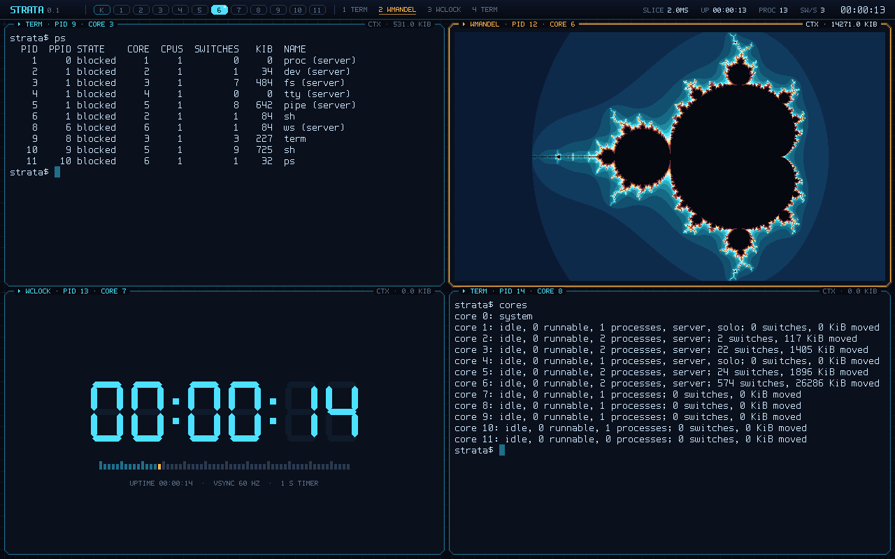

# Strata

A prototype 64-bit instruction set architecture in which **memory is
explicit I/O** and **every storage tier is visible to software** — with a
Verilog implementation, a reference emulator with a JIT, a microkernel
operating system written in its assembly language, a native-code Forth, and
a conformance suite that holds them all to the same behaviour.

- **[Project site](https://yrashk.github.io/strata/)**
- **[Run it in your browser](https://yrashk.github.io/strata/play/)**: the
  emulator as WebAssembly; boot StrataOS, draw into the framebuffer, type
  Forth
- **[Architecture Reference Manual](https://yrashk.github.io/strata/Strata-Architecture-Reference-Manual.pdf)** (PDF)
- **[Source browser](https://yrashk.github.io/strata/code/)**: every
  assembly and Forth source, syntax-coloured



## The ideas

- **Local Stores, not caches.** Loads and stores reach only registers and a
  per-core data **Local Store**; instructions come only from an instruction
  Local Store (4 to 64 KiB each, 64 by default: a platform parameter). L1 is
  an architectural scratchpad, and software decides what lives there.
- **Everything else is a transfer.** The cluster store, system memory and
  devices are reached through a per-core **Transfer Unit** (`tget`, `tput`,
  `tgetx`, with completion tags) or **far atomics** (`tamo`). There are no
  hardware caches; `ltag` / `linst` help software build its own.
- **Transfers are as-if-synchronous.** Each takes effect at its issue
  point, and the hardware stalls any access to a Local Store range that is
  still in flight. Overlapping transfers with computation is purely a
  performance choice.
- **Capabilities name everything.** Far memory is reachable only through
  capabilities. Writable capabilities are linear: they can be split,
  joined, given to another core and taken back, never copied. A data race
  between cores cannot be written down.
- **No interrupts.** A device "interrupts" by completing a transfer;
  `tany` waits for any of a set of transfers, or for a capability to arrive
  in the inbox. Ctrl-C is a console read that completes when the key is
  pressed; the timer is a read that completes at a deadline. The only
  forced preemption is stopping a core through a core-control capability.
- **Revocation by address** (`cdom`, `crevoke`, `cundom`) lets a supervisor
  take back every capability derived from a region at once: memory is
  revoked in 256 KiB granules, each with a generation, so there is no fixed
  number of revocable regions; **endpoints**
  (`csend`, `crecv`) carry capabilities between supervisor and user code.
- **Code is paged explicitly.** `xmap` / `xcall` / `xret` run code units
  out of system memory, and a miss traps so that software loads the unit.

## Repository layout

| Path | What |
|---|---|
| `rtl/` | The SystemVerilog implementation: decoder, ALU, divider, Transfer Unit, far memory and arbiter, devices, the multi-cycle core, the multi-core top |
| `sim/` | The Verilator harness: runs an `.stx` image on the RTL (`strata-rtl`) |
| `emu/` | `emu.c`, the C architectural emulator and reference semantics (`strata-emu`); `emu/jit/`, its JIT for arm64 and x86-64 hosts; `emu/debug*.c`, its debug engine (`--debug`) |
| `dbg/` | `strata-dbg`, the text debugger: gdb-like, a front-end of the debug engine |
| `asm/` | `sasm`, the two-pass assembler, and the shared encoding header `isa.h` |
| `common/` | The image loader, the platform description and the display / keyboard code shared by both simulators |
| `examples/` | Example programs for the bare machine, every line commented |
| `firmware/` | The boot ROM (`bootrom.s`) and the firmware interface library (`fw.s`) |
| `os/` | StrataOS 0.1: `kernel.s`, the resident kernel |
| `os/kunits/` | The rest of the kernel: code units the kernel pages into its own instruction store on demand |
| `os/servers/` | The servers, ordinary user processes: `proc`, `dev`, `fs`, `tty`, `pipe` |
| `os/lib/` | `sys.s` (the program library), `srv.s` (the server library), `gfx.s` (drawing), `wsclient.s` (the window server's protocol), the fonts |
| `os/progs/` | The shell `sh`, the utilities, the self-hosted assembler `as`, the window server's clients |
| `os/ws/` | The window server `ws`: main loop, protocol, renderers, and a bare-metal demo of them |
| `os/files/`, `os/demo.txt` | Files put on the disk (`motd`, `rc`); a scripted demo session |
| `lang/forth/` | Strata Forth: a kernel in assembly, the language in Forth, demos and tests |
| `conformance/` | The architectural conformance suite and a three-way differential fuzzer |
| `formal/` | Formal proofs of the RTL with SymbiYosys: specifications, property files, one `.sby` per target |
| `tools/` | Test scripts (`compare.sh`, `compare-boot.sh`, `test-*.sh`), `mkdisk` (bootable disks), `mkhex` (FPGA memory images), `bench-jit.sh`, `web-code.py` |
| `fpga/` | Synthesis script, LiteDRAM adapter, a board top, pin constraints |
| `web/` | The WebAssembly builds for the site's play page: the emulator (`web.c`), and the RTL simulator (`web_rtl.cpp`: Verilator's C++ compiled with Emscripten, `make wasm-rtl`) |
| `site/` | The project site: the landing page, `play/` (the in-browser emulator), `debug/` (the web debugger) and `code/` (the source browser) |
| `doc/` | The manual's LaTeX sources (`doc/manual/`), the StrataOS design specification (`doc/strataos.md`), schematics |
| `.github/workflows/` | CI: builds the manual, the WebAssembly emulator and the site, and publishes them |

## Building

| To build | You need |
|---|---|
| the assembler and the emulator | a C compiler (C11) |
| the RTL simulator | [Verilator](https://verilator.org) 5 (`brew install verilator`) |
| the framebuffer window | SDL2, found through `pkg-config` (optional: without it the simulators build headless and `-F` still writes frames) |
| the in-browser emulator and site (`make wasm`, `make web-site`) | Emscripten (`emcc`), node, python3 |
| the manual (`make manual`) | [tectonic](https://tectonic-typesetting.github.io/) |
| the fuzzers (`make fuzz`) | python3 |
| the formal proofs (`make formal`) | [SymbiYosys](https://github.com/YosysHQ/sby), Yosys, sv2v, Yices 2, Bitwuzla (`brew install sby yosys sv2v yices2 bitwuzla`) |

## Quick start

```bash
make                # build/sasm, build/strata-emu, build/strata-rtl
make test           # everything below, compared across the machines (several minutes)
make show-gfx       # eight cores draw a Mandelbrot set into the framebuffer window
make boot           # boot StrataOS on the emulator (12 cores), on the real network (NAT)
make boot-ws        # the same, with the window server started at boot
make forth          # a Forth prompt on the bare machine
make ws-demo        # the window server's renderers against a simulated system
make conformance    # the conformance suite on the interpreter, the JIT and the RTL
make formal         # the formal proofs of the RTL (about 15 minutes; not part of make test)
make bench          # interpreter against JIT, wall time
make web-site       # build/web-site/: the site with the in-browser emulator
make debug-pipeline # step an example under strata-dbg (any example: debug-NAME)
make debug-os       # boot StrataOS under strata-dbg
```

- `make` builds for 8 cores (`make NCORES=12` for more; the RTL's core
  count is fixed at build time, the emulator's is its `-c` flag, up to 15).
- `make test` runs every example on the emulator and the RTL and compares
  them **instruction by instruction**; boots StrataOS on both with a
  scripted session and compares the console output; stops a runaway program
  with Ctrl-C on both; runs a scripted interactive shell session, a
  preemption test, the session under the JIT, a framebuffer frame
  comparison, the JIT against the interpreter, and the conformance suite.
- `make run` / `make run-emu` show every example's output; `make run-NAME`
  runs one example on the RTL; `make show-NAME` (`show-rtl-NAME`) runs one
  and keeps its window open.
- `make boot` puts the machine on the network through the emulator's
  user-mode NAT and forwards host ports to it (`BOOT_NET`, default
  `-N nat,fwd=8080:80,fwd=8000:8000`; `make boot-net` is the same): type
  `httpd &` in the guest and open http://localhost:8080/ (the Forth
  `httpd.fs` on :8000). `ping example.com`, `host github.com`, `nc -H
  example.com 80 < request` reach the Internet. A busy host port is
  reported and skipped; `make boot BOOT_NET="-N peer"` stays offline.
- `make boot-demo` runs the scripted session (`os/demo.txt`);
  `make boot-rtl` and `make boot-rtl-demo` boot the Verilog simulator
  (slower).
- `make forth-demo-NAME` (`tiers`, `multicore`, `gfx`), `make test-forth`,
  `make test-jit`, `make fuzz SEEDS=N`, `make lint`, `make manual`.
- Preview the site: `python3 -m http.server --directory build/web-site`.

To assemble and run a program of your own:

```bash
build/sasm -o prog.stx prog.s && build/strata-emu -c 8 prog.stx
```

`sasm -l` prints a listing, `-T ADDR` sets the code origin and `-I DIR`
adds an include directory.

### Emulator and simulator flags

`build/strata-emu [flags] image.stx` and `build/strata-rtl [flags] image.stx`
take the same flags, except where noted.

| Flag | Meaning |
|---|---|
| `-c N` | cores, 1..15 (emulator only; default 4, the Makefile passes 8, and 12 for `make boot`) |
| `-d FILE` | block device image |
| `-i FILE` | console input from a file instead of the terminal |
| `-P FILE` | scripted pointer (mouse) input: `WHEN move X Y`, `down B`, `up B`, `wheel DY [DX]`, `enter`, `leave`; WHEN is a step (RTL: cycle) count, or `kN` after N console bytes |
| `-t FILE` | write an instruction trace |
| `-m N` | stop after N steps (emulator) or cycles (RTL) |
| `-b N` | press Ctrl-C after N steps / cycles (Ctrl-C at the terminal or in the window does the same) |
| `-T real\|virtual` | the timer: host microseconds (default), or machine time (deterministic; the tests use it) |
| `-S N`, `-X N` | the capability save table's entries per core (64..256, default 256) and the overlay map's (4..16, default 16); emulator only: the RTL's are build parameters (`make NXMAP=8`) |
| `-L D[,I]` | each core's D-LS and I-LS in KiB, powers of two 4..64 (default 64; I = D if omitted); emulator only: the RTL's are build parameters (`make DLS_KIB=32 ILS_KIB=16`) |
| `-r WxH` | framebuffer size, default 1280x800 (320x200 to 2560x1600, width a multiple of 8) |
| `-g none` | never open a window |
| `-F FILE` | at exit, write the last presented frame as a binary PPM |
| `-z N` | window scale |
| `-H` | keep the window open after every core has halted |
| `-J` / `-j` | force the JIT / the interpreter (emulator only) |
| `-N MODE` | the network interface's far end: `none` (default), `loop`, `peer[,nodns]` (an offline test host with DNS names `*.test`), `nat[,fwd=HOSTPORT:GUESTPORT]...` (the real network: guest 10.0.2.15, gateway/host 10.0.2.2, DNS 10.0.2.3), `udp:LPORT:HOST:RPORT` (a link to another simulator) |

A window opens the first time a program writes into the framebuffer. While
it has focus, keys go to the console input as a terminal would send them
(Alt+key as ESC [ 27 ; 3 ; code ~, Alt+arrows ESC [ 1 ; 3 X, the xterm
modified-key forms, so Esc and then a key is never Alt; Ctrl-C is the break
key).

## Examples

| Example | Shows |
|---|---|
| `hello` | Local Stores, output as a transfer, a token passed down a chain of cores |
| `stream_sum` | Streaming far data; plain against double-buffered |
| `swcache` | A software-managed set-associative cache with `ltag` / `linst` |
| `overlay` | Code in system memory, loaded on demand through `xcall` misses |
| `faults` | Precise transfer faults and the capability rules |
| `pipeline` | A two-core zero-copy producer and consumer, passing buffer ownership |
| `parsum` | A parallel reduction on all cores: `csplit` the array, far atomics, `cjoin` it back |
| `mandel` | Every core renders a band of one frame it exclusively owns; the bands are collected in order |
| `race` | The lost update, use-after-give and stale-read races, all impossible |
| `clock` | The timer: finding a device in the platform table, and waiting with `tany` for a deadline or a capability from another core, whichever comes first |
| `gfx` | A colour Mandelbrot set in the framebuffer: each core owns one band through a capability; the frame is byte-identical on the emulator and the RTL |

All of them but `clock` and `gfx` (which need the device root) are also on
the StrataOS disk and run there unchanged as programs: `-n 3 mandel` runs
it as three threads on three cores.

Output lines that start with `@` contain cycle counts. They differ between
the emulator (which has no timing) and the RTL, and `compare.sh` ignores
them.

## StrataOS 0.1

A microkernel with preemptive multitasking, written in Strata assembly,
where the explicit machine shows through instead of being hidden.

```
strata$ seq 30 | grep 2 | wc        # three processes, two pipes
strata$ -n 3 mandel &               # a bare-metal program as three threads
strata$ as < hello.s > hi && hi     # the assembler, written in Strata assembly
strata$ ps                          # context switches and KiB moved, per process
strata$ sched 500us                 # change the time slice and watch the cost
strata$ ws                          # the window server takes the screen
```

- **The kernel is the system core plus a dispatcher on every worker core.**
  Core 0 runs only the kernel: it creates and destroys processes, hands out
  memory (arenas, 1 MiB by default, revoked by address when a process ends,
  so that ending a process takes back every capability it held or lent
  out), and owns the timer. Each
  worker core's dispatcher runs that core's threads and sorts every
  capability that arrives in its inbox.
- **The kernel pages itself.** A few kilobytes stay resident; the rest is
  code units it loads into its own instruction store on demand, with the
  same `xcall` / miss mechanism programs use.
- **Servers are processes.** `proc` (processes, names, signals), `dev`
  (devices), `fs` (files, with tags instead of directories; it drives the
  block device from user mode), `tty` (the console, Ctrl-C) and `pipe` run
  in user mode, one per core. A message
  is a lent buffer capability: a program gives its 4 KiB buffer to a server
  through an endpoint and gets it back with the answer. Nothing is copied
  between address spaces, because there are none.
- **Preemption with a visible cost.** The system core stops, through core
  control, every worker that has more than one runnable thread, each time
  slice: 2 ms by default, configurable from 100 µs to 100 ms (`sched`). A
  context switch copies out the part of the Local Store a program uses and
  reloads the next one's — the cache flush other machines hide. `ps`,
  `cores`, `uptime` and `sched` show switches and kilobytes moved.
- **Bare-metal programs run unchanged.** Inbox instructions trap in user
  mode and the dispatcher emulates them, so the examples run as
  time-shared threads on a window of cores.
- **A second OS can run beside it.** `guest [-d] IMAGE [cores] [MiB]` takes free
  worker cores out of StrataOS's scheduling and boots an untrusted guest
  operating system on them in supervisor mode, with only an arena (its
  memory, one revocation domain), a console channel through `tty`, a
  read-only clock and core control over its own cores. The guest reaches
  nothing else; `cores` shows its cores as a guest's, and `guest stop ID`
  **resets** those cores (a core-control reset stops a supervisor that will
  not yield), revokes everything the guest holds or lent out, and returns
  the cores to StrataOS. `guest forth 2 16` boots the bare-metal Strata
  Forth as a guest on two cores and gives it the console (Ctrl-] gives it
  back; `lang/forth/guest/`); `guest -d gdemo 2 8` boots a tiny demo guest;
  `guest -d ghostile 2 8` is a hostile one whose every out-of-grant access
  faults (`os/guests/`, `doc/strataos.md` "Guests"). Two small ISA
  additions make reclaiming a supervisor-mode core sound: a core-control
  reset request, and a block device that pairs a buffer only with a command
  from the same core.
- **The shell** (`sh`) has line editing, history, Tab completion of
  commands and file names, quoting and variables, `;` `&&` `||`, pipelines
  of up to four stages, redirection, background jobs (`jobs`, `fg`, `wait`,
  `kill`), scripts and an `rc` file, and a current tag path: `cd src/demo`,
  `cd ..`, `pwd`; names without a leading `/` are read under it (`ls`,
  `cat hello.s`, `echo hi > notes` tags the new file), programs started from
  there inherit it, and the prompt shows it (`strata:/src/demo$ `). Type
  `help`.
- **Utilities**: `ls cat cp mv rm touch df tag untag retag tags ps free
  uptime devs hexdump cores sched seq grep wc upper spin`, `units` (a program
  that pages its own code), and `as`.
- **The editor** (`vi FILE`): vi keys (motions, counts, `d c y` operators,
  put, many-level undo and redo, `.`, search, `:w :q :e :set nu`) on the
  console or in a window, Strata assembly and Forth in the site's colours
  (keyword tables generated from the assembler and Forth sources), the
  screen's size asked of the terminal, and the text kept in far memory, so a
  file far bigger than the 64 KiB Local Store opens (the 333 KiB shell
  source does).
- **Networking**: the `net` server (IPv4, ICMP, UDP, TCP, a DNS resolver)
  and `ping host nc tcpecho ifconfig netstat httpd`. `httpd &` serves the disk
  over HTTP: URLs are tag paths (`/src/demo/hello.s`, `/src/` lists the files
  tagged `src`), `/` is the small site tagged `www`, `/~ps` shows what the
  machine is doing (doc/strataos.md 2.11). With `-N nat` the machine is on the
  real network; `tools/netrelay` does the same for the browser's play page.
  The sources of the programs and examples are on the disk, so they can be
  rebuilt on the machine (each utility's with the library appended). The
  disk is 16 MiB.
- **Cores.** `make boot` boots 12 cores: the system core, five servers and
  six cores free for threads. The minimum is 6 (the shell then shares a
  server's core). A worker core holds up to 16 threads (its 256-entry
  capability save table is a pool of slots; endpoints and device
  capabilities are rebuilt on switch-in rather than saved).

Boot goes: boot ROM (firmware) → platform table → block device → boot
header → the kernel into every core's Local Stores. The kernel loads
`proc`, `dev` and `fs` from the disk itself; `proc` starts `tty`, `pipe`
and the login shell.

The design, the message protocol and every operation number are in
[`doc/strataos.md`](doc/strataos.md) and in the manual's StrataOS chapter.

### The window server

`ws`, typed at the shell, starts the window server: an ordinary program
that becomes the server of a free core, takes the framebuffer and the
keyboard, and tiles up to four windows on a grid. It is the only process
that touches the framebuffer. No store can reach the framebuffer, so
nothing is drawn in place: the screen is a display list, rendered strip by
strip in the Local Store and sent out with transfers, and only damaged
rectangles are redrawn. The strip at the top has one cell per core, lit in
the colour of the process running there and pulsing on every context
switch; each window's tag shows the kilobytes its context switches have
moved.

Windows belong to client programs: `term` (a terminal running `sh -i`
behind two pipes), `wmandel` and `wclock`. Because memory capabilities are
linear, a client draws into a band of its own memory and *lends* it to the
server with each damage request; the server copies the rows into the
window's surface and gives the band back.

Keys (Alt+key has bytes of its own, so Esc and then a key is just that:
vi's Esc then `p` is a put): Alt+Enter a new terminal, Alt+P (or
Alt+Space) the launch palette, Alt+1..4 and Alt+arrows focus, Alt+Q close,
Alt+Shift+Q back to the shell, Alt+? the key help (also shown when the
splash ends; any key or click dismisses it).

The mouse is the machine's pointer device (0x4100: a queue of move,
button and wheel events). `tty`, alone on its core, keeps its waiting read
and hands the events to `ws` with the keys. `ws` draws a cursor; a click
focuses the tile under it or runs a program from the palette; the window
under the pointer gets clicks, drags and the wheel, and `term` scrolls back
through its history with the wheel. `make boot-ws` boots straight into the
window server.


`make ws-demo` runs the same renderers on the bare machine against a
simulated twelve-core system (no OS needed), and the site's play page has
it as a preset. See [`os/ws/README.md`](os/ws/README.md).

### `as`: the assembler in Strata assembly

`os/progs/as.s` is a second implementation of `sasm`, written in Strata
assembly. It accepts the same language and writes byte-identical images, so
it can assemble programs (and itself) on the emulator, on the RTL, or as a
StrataOS program. `.include` lines are skipped (the program has no file
system of its own): put the included files into the input yourself.

```bash
build/sasm -o as.stx os/progs/as.s                   # bare metal build
cat prog.s lib.s > all.s
build/strata-emu -c 1 -i all.s as.stx > prog.stx     # source on the console in, image out
#   in StrataOS:  strata$ as < prog.s > prog
```

`tools/test-as.sh` checks it against `sasm` on every example, the kernel,
the boot ROM, itself, a feature test and a set of inputs both must reject,
and runs it under a StrataOS boot.

## Strata Forth

A Forth bootstrapped the classic way — a small kernel in assembly
(`lang/forth/forth.s`), the rest of the language in Forth (`core.fs`) —
whose words compile to **native Strata code**. Stores cannot write
instruction memory, so every definition is written to far memory and
installed with `tgetx`: a JIT whose install step you can watch (`see`,
`.jit`). Capabilities, transfers and tags are ordinary words; `far@` /
`far!` go through a software cache built on `ltag` / `linst`; `spawn` /
`await` run words on other cores; and it has locals, quotations and
`catch` / `throw`.

```bash
make forth              # the prompt, on the bare machine (emulator)
make forth-demo-gfx     # a parallel Mandelbrot set, drawn from Forth
make test-forth         # the regression test, emulator and RTL compared
```

It runs on the bare machine, on both the emulator and the RTL. See
[`lang/forth/README.md`](lang/forth/README.md).

## The emulator's JIT

`strata-emu` translates the plain integer instructions to host code
(`emu/jit/`, arm64 and x86-64 hosts; other hosts interpret) and runs each
core for a quantum of steps per turn; everything else — transfers,
capabilities, traps — is interpreted, and traps stay precise. The JIT is
the default, except with `-t` or `-T virtual`, which keep the reference
one-instruction interleaving that trace comparisons need. `-J` / `-j` force
one or the other. `make test-jit` checks the JIT against the interpreter on
every example and the Forth tests, and `make bench` compares their speed.
The in-browser build interprets.

## Debugging

The emulator has a debug engine (`strata-emu --debug`, `emu/debug.c`) and
two front-ends for it: `strata-dbg`, a gdb-like text debugger, and a web
debugger (`site/debug/`, on the site next to the play page, or served by the
engine itself). They step like gdb, but they show what is particular to
this machine: every core side by side, the 16 transfer tags of each core
and the transfers in flight, pending device reads and what they wait for,
why a core is stalled, capabilities decoded (live or revoked) with the
history of each one, the save table, inboxes, the overlay map. Nothing in
the ISA changes: breakpoints and watchpoints live in the emulator, and
without `--debug` it runs exactly as before.

```bash
make debug-hello          # strata-dbg on an example (debug-NAME for any)
make debug-os             # StrataOS, with process awareness
make debug-web            # the engine on port 4444: http://localhost:4444/debug/ (DEBUG_WEB=NAME)
make debug-web-os         # the same with StrataOS: the page's Run menu types at its shell
build/strata-dbg -c 4 -j -T virtual build/examples/pipeline.stx
```

```
(sdb) break print_str                    # also file.s:LINE, an address, `break process ls`
(sdb) watch dls buf 8 core 1             # Local Store bytes, written by a store or a transfer
(sdb) continue
(sdb) info tags                          # the current core's tags: op, ranges, issue and completion
(sdb) info pending                       # device reads in flight and what each one waits for
(sdb) info cores                         # every core: where, what, and why it is stalled
(sdb) reverse-stepi                      # time travel on deterministic runs (-T virtual)
(sdb) prov c4                            # where a capability came from: split, given, taken...
(sdb) tui                                # the cores side by side
```

- `sasm -g FILE` writes a symbol and line map; the Makefile writes one for
  every image (`build/examples/NAME.map`, the boot ROM, the kernel, every
  program on the disk), so the debuggers show labels and source lines, and
  breakpoints take `label` and `file.s:LINE`. Under StrataOS (`--os build`)
  they also show processes, which process each core runs, the kernel's
  paged code units by name, and `break process NAME` stops when it runs;
  `follow PID` makes `stepi` follow a thread across switches and cores.
  Forth code is named by its dictionary.
- Time travel needs a deterministic run (`-T virtual`, no network): the
  engine keeps snapshots and a log of what came from outside, and goes back
  by replaying: `reverse-stepi`, `reverse-continue`, `reverse-step-round`,
  `reverse-tag tgN`, `goto TICK`. `ff` (fast) catches up without recording,
  with the JIT under `-J`, and the history starts again where it stops: boot
  StrataOS that way, then debug from there.
- The guest's console never mixes with the debugger's: strata-dbg opens a
  pty for it (`screen /dev/ttys012` in another terminal: what you type
  there is the guest's input), or `--console FILE`.
- The web debugger adds the transfer timeline (a row per core: transfers,
  device reads in flight, stalls, gifts), a Local Store map, the
  capability provenance graph and a time slider. In the page it runs the
  WebAssembly emulator; served by `strata-emu --debug PORT` it drives the
  desktop engine over a WebSocket.
- The protocol (JSON lines over stdio, a TCP port with WebSocket, a Unix
  socket, or the browser build's exports) is in
  [`doc/debug-protocol.md`](doc/debug-protocol.md); `make test-dbg` runs
  the debuggers' tests.

The emulator completes memory transfers at the instant they issue (that is
its reference semantics), so in a debugger only device reads stay in flight
(the console, the timer's WAIT, VSYNC, the network); memory transfers show
as instants on the timeline.

## Conformance

`conformance/` is an architectural conformance suite: self-checking
assembly tests whose signature regions must be identical on three machines
— the emulator's interpreter, the emulator with the JIT, and the RTL. It
covers the integer instructions and their edge cases, every trap cause with
precise `epc` / `tval`, the capability rules (linearity, split / join /
restrict / share, revocation by address, endpoints, the save table), transfer
hazards and faults, the devices (timer, framebuffer controller, console,
block device, platform table) and multi-core behaviour (gifts, inbox
queues, `tany`, core-control stop).

```bash
make conformance        # the table: test x machine
make fuzz SEEDS=200     # random instruction streams on all three, compared
```

The discrepancies the suite found, and how each was decided, are recorded
in [`conformance/FINDINGS.md`](conformance/FINDINGS.md).

## Formal verification

`formal/` proves properties of the RTL for every input sequence, with
[SymbiYosys](https://github.com/YosysHQ/sby): the ALU and the decoder
against written specifications, the divider and the multiplier (correct
result, fixed number of cycles), the far bus (one owner, no beat lost,
bounded waiting), the Transfer Unit (queue invariants, hazards, order, no
command lost), the memory and device targets (the burst protocol), the core (x0, precise traps, privilege, capability shape and
liveness, no duplicated write access) and the top level's inboxes and
revocation walker. Each property file states what it assumes;
[`formal/README.md`](formal/README.md) has the table of proofs and what is
not covered, [`formal/FINDINGS.md`](formal/FINDINGS.md) what was found (two
RTL bugs, both fixed, each with a program that shows it).

```bash
make formal             # every proof, then the table of results
make formal-tu          # one target (alu decode div mul mul_lemma bus tu mem dev core top)
```

## FPGA

The RTL is synthesizable (Yosys via `sv2v`; `fpga/synth.sh xc7|ecp5`).
The one-core system is about 30k LUTs on Xilinx 7-series (each further
core about 28k): one core takes half an Arty A7-100T, and the 2-core
system (58,066 LUTs) fits an XC7A200T board such as the Digilent Nexys
Video. On Lattice ECP5 one core takes 41k of an 85F's 84k LUT4 sites;
the block RAM of two cores' Local Stores does not fit it. `fpga/arty/` is
the board top (two cores), with LiteDRAM for the DDR3. StrataOS needs six
cores, which is 168,694 LUTs: more than any Artix-7, within a Kintex-7 325T.
`make test-small` checks the configuration with 8 overlay map entries
suggested for small FPGAs. See `fpga/README.md` for the numbers and where
the logic goes. Nothing has been
placed and routed, and it has not yet run on hardware.

There is no video output on FPGA yet: the framebuffer is memory only, and
the console is a UART.

## Documentation

- The [Strata Architecture Reference Manual](https://yrashk.github.io/strata/Strata-Architecture-Reference-Manual.pdf):
  the architecture, every instruction, the platform and firmware, StrataOS,
  Forth and the toolchain. The PDF is not in the repository: CI builds it
  from `doc/manual/` and publishes it on
  [the project site](https://yrashk.github.io/strata/). To build it
  locally: `make manual` (needs tectonic).
- [`doc/strataos.md`](doc/strataos.md): the devices and StrataOS,
  as a specification.
- [`doc/debug-protocol.md`](doc/debug-protocol.md): the debug engine's
  protocol and the symbol map format.
- [`ROADMAP.md`](ROADMAP.md): what exists, what is missing, what is next.
- The sources: every line of assembly is commented, and each file starts
  with a description of what it does and why.

## Known limitations

Strata is a prototype. The longer list is in [`ROADMAP.md`](ROADMAP.md);
the main points:

- It has never run on hardware. The RTL is not pipelined, and the 6 cores
  StrataOS needs are more than a hobby FPGA holds.
- A worker core holds at most 16 threads (the kernel's process records;
  the 256-entry capability save table reserves all their capabilities),
  and StrataOS needs at least 6 cores (one server per core). The number of
  processes is otherwise limited by memory (a 46 MiB arena pool, 1 MiB per
  process by default) and by 64-entry kernel and server tables: 15 cores
  run 35 processes at once, 6 cores 43 (`tools/test-procs.sh`).
- A console read cannot be cancelled, so `halt` may wait for one more key
  when a program was waiting for input.
- The file system has tags instead of directories (`ls /src/demo` lists
  the files tagged both `src` and `demo`, `ls /src/-demo` those tagged `src`
  but not `demo`; subdirectories are facets: `ls /src` ends with `demo/`), but files are contiguous runs of
  blocks, a deleted file's space comes back only if it was the last one, and
  a disk holds at most 128 files and 64 tags.
- The shell has no globbing and no `2>`.
- Strata Forth runs on the bare machine only, not yet as a StrataOS program.
- With timer-driven preemption, the emulator and the RTL cannot be compared
  instruction by instruction on an OS boot (their time bases differ); that
  comparison is of console output. The examples and the conformance suite
  are compared exactly.

## License

Licensed under either of

- Apache License, Version 2.0 ([`LICENSE-APACHE`](LICENSE-APACHE))
- MIT license ([`LICENSE-MIT`](LICENSE-MIT))

at your option. Unless you explicitly state otherwise, any contribution
intentionally submitted for inclusion in this work, as defined in the
Apache-2.0 license, shall be dual licensed as above, without any additional
terms or conditions.
